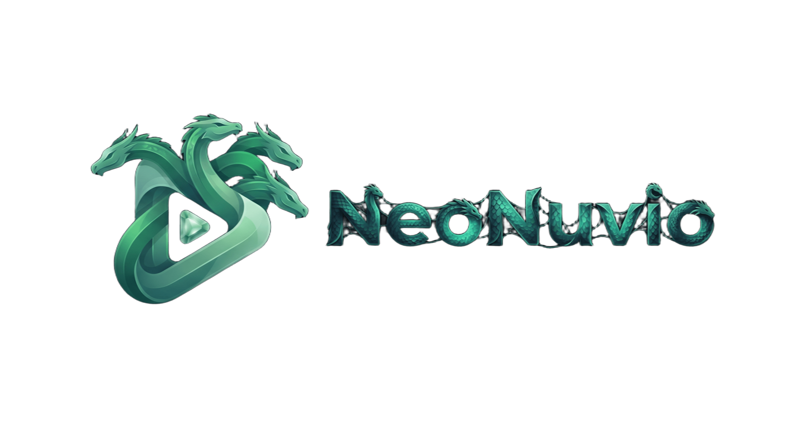

  <b>English</b> | <a href="README_PT.md">Português (Brasil)</a>

    

  

  

    <b>Complete media player for Android TV. The evolution of NuvioTV.</b>
     
    Bring your own sources. NeoNuvio transforms your media into an organized hub with covers, overviews, ratings, subtitles, and progress tracking, featuring the most requested and latest features from the open-source revolution.
  

  

    
    
    
    
     
    
  

  
<b>Downloader code: 9305323</b>

---

## 🆕 What's New

**NeoNuvio v1.0.0 Initial Release (Based on Nuvio 1.1.0 - beta 7):**

* 🎯 **Source Memory & Priority for TV Series:** You can now pin a preferred stream source for any TV series. When advancing to the next episode, NeoNuvio automatically searches and plays that same preferred source without jumping to random streams.
* 🎨 **All Themes & Colors 100% Unlocked:** Every visual style and theme is completely free for all users, including the new immersive color mode that adapts vibrant accents across all UI elements, from buttons to menus.
* 🎛️ **Streamlined Player Controls:** The bottom control bar was redesigned: the default view remains clean and focused on playback, while pressing right expands advanced actions (Switch Player, Episode Selector, and Watch Party).
* 🔄 **Integrated Smart In-App Updater:** Direct updates from NeoNuvio's GitHub repository with automatic CPU architecture detection (ARM64, ARMv7, x86, Universal), downloading and installing the APK directly on your device.
* ☕ **Voluntary Support via Ko-fi:** Anyone who wishes to support continuous development can make a voluntary donation via Ko-fi using the QR code directly on TV.

---

## ✨ Features

Discover the features and enhancements that make **NeoNuvio** the ultimate media experience for TVs:

### 🎬 Smart Series & Stream Source Management
* **Preferred Source Selection:** Pin your preferred source (e.g., your favorite server) with the menu button.
* **Seamless Continuity Between Episodes:**
  * **Priority 1:** The next episode automatically finds and loads the exact same source pinned as favorite for the series.
  * **Priority 2:** If no favorite is set, the player keeps the same stream source and profile from the current episode.
  * No more having to pick sources after every single episode!

### 📅 Release Calendar
* By adding series and movies to your watch later list, or simply watching their episodes, the calendar displays upcoming episode release dates and movie premieres.

### 📲 Full Simkl Integration
When logging in with your Simkl account:
* **Watch History Sync:** Your watched items are automatically marked as completed in your library.
* **Watch Later:** Content automatically syncs to your library's watch later list.
* **Ratings Sync:** Ratings you give to movies and series (a newly implemented feature accessible in the content details after fully watching) are saved to Simkl and vice versa, keeping your ratings in sync across platforms.

### 🎛️ Streamlined Player Controls
* The bottom control bar was redesigned: the default view remains clean and focused on playback, while pressing right expands advanced options (Switch Player, Episode Selector, and Watch Party).

### ⚡ X-Ray Mode (Experimental)
* You can enable X-Ray mode in settings. When active, pausing content displays scene details such as cast members and soundtrack music.

### 🔎 Complete Redesign of Search Menu
* The search menu has been completely redesigned for a smoother user experience.
* When selecting TV content, a catalog, and a genre, you can press the menu button on the chosen genre to save that preset. This automatically pre-loads your selected catalog and genre whenever you open the TV section, speeding up everyday navigation if you frequently watch the same live channels.

### 🎨 Complete & Free Visual Customization
* **Unlocked Themes:** Free access to all featured themes (Amethyst, Emerald, Rose Gold, Sunset, Amber, Ruby, Jade, Obsidian, and more).
* **Highlight Palettes:** Customizable focus effects, gradients, and ambient lighting tailored for your TV.
* **Adapted Banners & Icons:** Modern and polished look both on the Android TV launcher and during app splash loading.

### 📺 High-Performance Media Playback
* **Clean Two-Tier Layout:** Minimalist control bar for daily viewing, with an expanded panel revealing player switching, fast episode selection, and Watch Party.
* **Full Dolby Vision Support (Profile 7 to 8.1):** Integration with the native `libdovi` / `dovi_bridge` library, converting Dolby Vision Profile 7 to Profile 8.1 on the fly to eliminate black screens or distorted colors on standard TVs.
* **Advanced Audio Downmixing:** Native downmixing of multichannel tracks (5.1/7.1, AC3, EAC3, DTS) to crystal-clear stereo for TV speakers.

### 🚀 Streamlined Updates
* **No Beta Hassles:** Every release published by NeoNuvio is stable and ready for daily use.
* **Direct TV Download:** Checks GitHub releases, picks the exact architecture for your processor (ARM64, ARMv7, x86, or Universal), and installs with a single click.

### 🤝 Transparent Community Support
* No paid plans, no ads, and no locked features.
* If you'd like to support the developer's work, feel free to contribute at [ko-fi.com/pedropicoli](https://ko-fi.com/pedropicoli).

---

## 🛠️ Technology Stack

NeoNuvio is built using modern Android TV technologies:
* **Language:** Kotlin
* **UI:** Jetpack Compose for TV & TV Material 3
* **Playback:** Jetpack Media3 (ExoPlayer) with FFmpeg extensions and advanced decoders
* **Architecture:** Clean Architecture with Jetpack Hilt (dependency injection) and Coroutines/Flow
* **Video Processing:** Native libdovi for Dolby Vision metadata manipulation

---

## 📄 License

This project is free software licensed under the [GNU General Public License v3.0](./LICENSE).  
Based on the open-source project [NuvioMedia/NuvioTV](https://github.com/NuvioMedia/NuvioTV).
